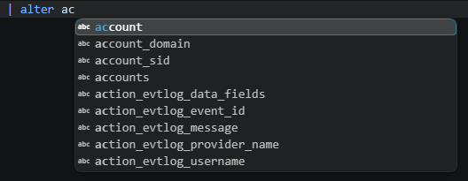
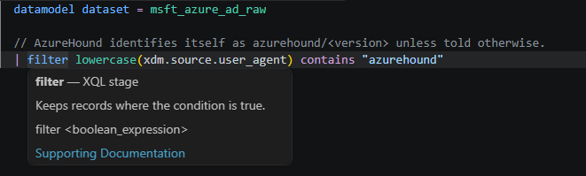
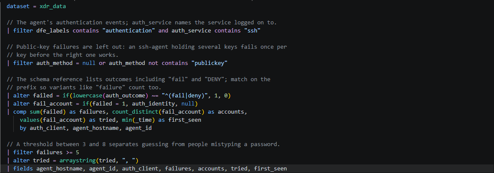
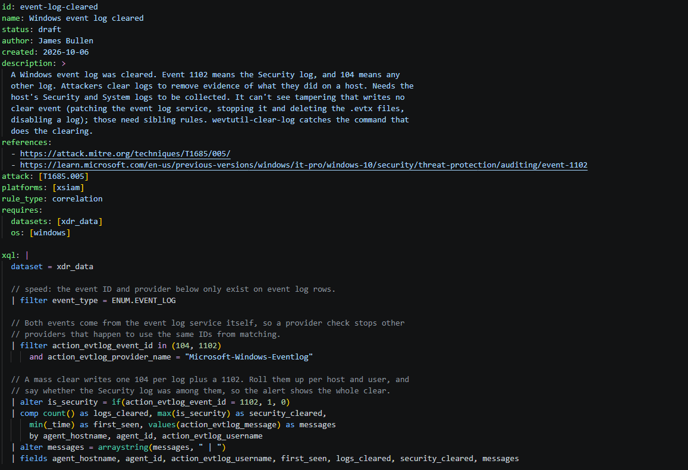

# XQLibur

XQL language support for VS Code: highlighting, completion, hover help, argument
hints and diagnostics. Use it in `.xql` files and `xql: |` blocks inside YAML.

Everything runs locally. XQLibur never executes queries or uploads your text.

> **Preview.** Editor checks cover documented forms; a clean Problems panel does
> not prove that a query will run in Cortex.

XQLibur is independent and is not affiliated with or endorsed by Palo Alto Networks.
Cortex and XQL identify the supported language.

## Get started

1. Install **XQLibur** from the Extensions view, or use **Extensions: Install from
   VSIX…** for a local preview package.
2. Open a `.xql` file, or select **XQL** in the status bar.
3. Start typing. In YAML, place the query inside a plain `xql: |` literal block.

If another XQL extension provides overlapping features, disable it for the
workspace. XQLibur does not change file associations or other extensions.

## Complete fields as you type

Suggestions include fields defined earlier in your query, alongside stage and
function names. Function suggestions follow the current stage, so aggregates
appear where they can be used.



## Understand stages and functions

Hover over a stage to see what it does and open its supporting documentation.
All 28 supported stages have definitions. Function help includes official
reference links, reviewed summaries where available, and argument hints that
follow nested calls and optional or repeated parameters.



## Read queries more easily

Highlighting distinguishes stages, functions, operators, strings, comments and
dataset sources. Semantic roles identify fields, declarations and aliases.
Colours follow your theme and editor customisations.



## Keep XQL help inside YAML

Detection rules can keep their queries in place. Plain `xql: |` blocks receive
completion, hover help, argument hints, diagnostics and XQL highlighting, including
nested investigation blocks. The surrounding document keeps its YAML support.



Use a plain literal block such as:

```yaml
xql: |
  dataset = example_dataset
  | filter action = "allow"
  | comp count() as total by host
```

## Catch common mistakes

Diagnostics identify structural problems, argument counts for 130 reviewed
functions, and fields removed by earlier stages. Unknown names are warnings.
Partially reviewed forms stay conservative. Untitled documents, Restricted Mode
and virtual workspaces are supported.

## Limits

- Complete XQL syntax, implicit operator precedence and argument types are not
  verified. Argument counts are checked only for the 130 reviewed functions;
  partially reviewed functions are never rejected.
- Field availability depends on your tenant's schemas, which XQLibur does not
  read. Field help comes only from what the query itself defines.
- In YAML, folded (`>`), quoted, explicitly indented and templated values are not
  analyzed. XQLibur does not color YAML documents semantically.
- No formatting, schema-backed completion or query execution.

## Theme fallback

<details>
<summary>Adjust theme colours</summary>

Some themes only color scopes from specific languages. XQLibur supplies default
XQL-only stage and function colors for Eclipse Dark, which otherwise leaves those
tokens in the ordinary foreground. The defaults do not change other languages or
themes. You can override them in VS Code's user settings; this example shows the
default colors and XQL-specific scopes to adjust:

```jsonc
"editor.tokenColorCustomizations": {
  "[Eclipse Dark]": {
    "textMateRules": [
      { "scope": "keyword.control.xql", "settings": { "foreground": "#E88537" } },
      { "scope": "keyword.control.clause.xql", "settings": { "foreground": "#E88537" } },
      { "scope": "keyword.operator.word.xql", "settings": { "foreground": "#E88537" } },
      { "scope": "keyword.operator.xql", "settings": { "foreground": "#E88537" } },
      { "scope": "support.function.xql", "settings": { "foreground": "#A7EC21" } },
      { "scope": "entity.name.function.xql", "settings": { "foreground": "#A7EC21" } }
    ]
  }
}
```

Merge the example with any existing customization instead of replacing it. The
extension contributes defaults but does not write user settings. Adapt or omit the
colors to meet your contrast needs. Semantic and lexical theme rules and user
overrides can differ; no palette can guarantee readability for every configuration.
VS Code's bracket pair colorization can also override bracket scope colors.

### Dark 2026

Dark 2026 uses XQL-specific defaults to distinguish blue stages, teal functions,
lavender operators and grey bracket scopes. Fields and variables retain the theme's
colours. To adjust these defaults, merge this into existing user customizations:

```jsonc
"editor.tokenColorCustomizations": {
  "[Dark 2026]": {
    "textMateRules": [
      { "scope": "keyword.control.xql", "settings": { "foreground": "#6CB6FF" } },
      { "scope": "keyword.control.clause.xql", "settings": { "foreground": "#6CB6FF" } },
      { "scope": "keyword.operator.word.xql", "settings": { "foreground": "#C8A0DE" } },
      { "scope": "keyword.operator.xql", "settings": { "foreground": "#C8A0DE" } },
      { "scope": "support.function.xql", "settings": { "foreground": "#4EC9B0" } },
      { "scope": "entity.name.function.xql", "settings": { "foreground": "#4EC9B0" } },
      { "scope": "punctuation.section.parens.begin.xql, punctuation.section.parens.end.xql, punctuation.section.brackets.begin.xql, punctuation.section.brackets.end.xql, punctuation.section.braces.begin.xql, punctuation.section.braces.end.xql", "settings": { "foreground": "#B0BEC5" } }
    ]
  }
}
```

Bracket pair colorization and user semantic rules can override these defaults.

</details>

## Privacy

No telemetry, uploads, credential access, workspace scanning or network requests.
Open documents are analyzed in memory by a bundled language server. See
[PRIVACY.md](PRIVACY.md).

## Contributing and feedback

Report bugs and suggestions on
[GitHub Issues](https://github.com/FantasticSalad/xqlibur/issues) using synthetic
examples only. Never include real queries, tenant identifiers, query output or
credentials. Report security problems privately as described in
[SECURITY.md](SECURITY.md). See [CONTRIBUTING.md](CONTRIBUTING.md) to build and
test from source.

## Development

<details>
<summary>Build and test from source</summary>

`packages/core` holds editor-independent analysis, `packages/language-server`
exposes it through LSP and `packages/vscode` is the thin client. Reference data is
bundled; `npm run reference:update` fetches public symbol names and links and
requires review before commit. Build with Node.js 22 or later:

```
npm ci
npm run check
npm test
npm run package
npm run test:package
```

`npm run test:package` checks the VSIX file allowlist and runs the extracted
package in an isolated VS Code profile in Restricted Mode. Set
`XQLIBUR_TEST_VSCODE_EXECUTABLE` to reuse an existing VS Code executable. The
parser limits are in [docs/parser.md](docs/parser.md); release steps are in
[docs/RELEASING.md](docs/RELEASING.md). Third-party notices are in
[THIRD_PARTY_NOTICES.md](THIRD_PARTY_NOTICES.md).

</details>
